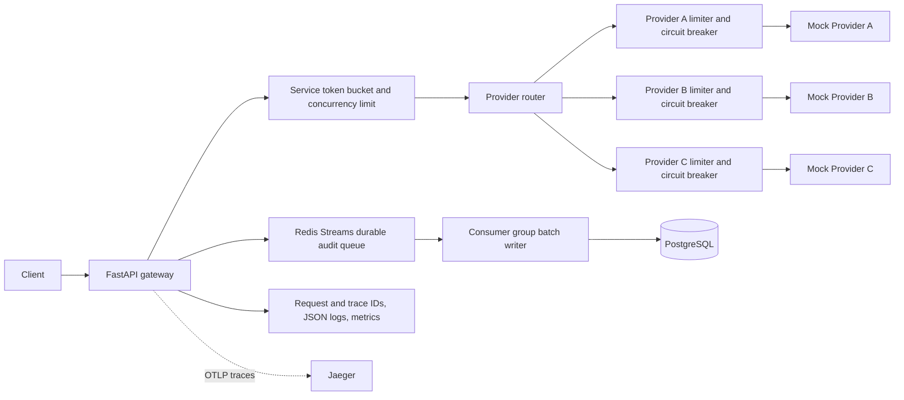

# Multi-Provider API Gateway

An asynchronous FastAPI gateway that routes requests to three mock providers,
limits upstream load, and records request/result metadata in PostgreSQL.

## Run locally

Requirements: Docker and Docker Compose.

```bash
cp .env.example .env
docker compose up --build
```

The API listens on `http://localhost:8000`. `GET /health` checks the API process;
`GET /metrics` exposes Prometheus-format request counters and latency buckets.

Submit a request with a provider selector (`a`, `b`, or `c`):

```bash
curl -i -X POST 'http://localhost:8000/api/v1/process?provider=a' \
  -H 'Content-Type: application/json' \
  -H 'Idempotency-Key: order-123' \
  -d '{"amount": 1000, "currency": "IRR"}'
```

The gateway returns the provider response and includes `X-Request-ID`,
`X-Trace-ID`, and `X-Gateway-Provider` response headers. Pass `X-Request-ID` to
correlate a request across services; otherwise the gateway generates one.

## Architecture and request flow



FastAPI and `httpx.AsyncClient` keep upstream I/O asynchronous. Each provider
has an independent token bucket, concurrency cap, and circuit breaker. Retries
are disabled by default. When enabled, they require an idempotency key and only
retry transport failures or 5xx responses with exponential backoff. Provider
4xx responses such as 429 are returned directly and are not retried.

Redis runs with AOF persistence and `noeviction`. An atomic reservation bounds
the audit stream before the gateway accepts work, so a full queue applies
backpressure instead of growing without limit. A Redis consumer group batches
inserts into PostgreSQL; messages are acknowledged and deleted only after the
database transaction succeeds. Retries are safe because each stream entry ID is
unique in the table. Alembic applies schema migrations before API and worker
startup.

The event table stores request/trace IDs, provider, timestamps, duration,
gateway/upstream statuses, request payload, response JSON (or up to 4 KiB of
non-JSON text), and error class. Redis-backed atomic token buckets and expiring
concurrency leases share service and per-provider limits across API replicas.
Expired leases recover capacity after process crashes. Circuit breakers are
currently local to each API process. Structured JSON logs include request and
trace IDs; OpenTelemetry exports HTTP server/client spans to the bundled
Jaeger instance (UI at `http://localhost:16686`).

## Configuration

Copy `.env.example` to `.env`. Provider URLs, timeout values, retry policy,
service capacity, and each provider's rate/burst/concurrency limits are
configurable with environment variables. The defaults are conservative local
limits and should be tuned against the mock provider behavior.

## Benchmark

Start the stack, then run a closed-loop benchmark or specify a fixed offered
rate (open-loop):

```bash
python scripts/benchmark.py --provider a --duration 60 --concurrency 10
python scripts/benchmark.py --provider b --duration 60 --concurrency 20
python scripts/benchmark.py --provider a --duration 10 --rps 1000
python scripts/benchmark.py --provider a --duration 5 --rps 10000 --max-in-flight 2000
```

The script reports offered rate, actual request throughput, successful
throughput, average/P95/P99 latency, status counts, error rate, and client-side
drops (when `--max-in-flight` is reached). Closed-loop concurrency is the number
of client workers. Fixed-rate runs are best for checking admission behavior;
they do not represent provider capacity when requests are shed by the gateway.
Run the benchmark from a machine with network access to the mock providers.
On 2026-10-19, one API container with defaults and the live mock providers
produced these short runs:

| Provider / offered load | Completed | Client drops | Successful | Throughput | Successful RPS | Avg | P95 | P99 | Error rate |
| --- | ---: | ---: | ---: | ---: | ---: | ---: | ---: | ---: | ---: |
| A, 1,000 RPS for 3s | 2,019 | 981 | 21 | 479.19 RPS | 4.98 RPS | 665.83 ms | 1,011.90 ms | 1,322.45 ms | 98.96% |
| A, 10,000 RPS for 2s | 1,410 | 18,590 | 15 | 436.22 RPS | 4.64 RPS | 740.19 ms | 1,231.64 ms | 1,245.92 ms | 98.94% |
| B, one request | 1 | 0 | 1 | 0.15 RPS | 0.15 RPS | 6,805.51 ms | 6,805.51 ms | 6,805.51 ms | 0.00% |
| C, one request | 1 | 0 | 1 | 0.64 RPS | 0.64 RPS | 1,566.43 ms | 1,566.43 ms | 1,566.43 ms | 0.00% |

Provider A stayed near its configured 5 RPS successful limit under overload. The
large 503 count reflects backpressure and provider circuit/capacity rejection;
the fixed-rate client also dropped work after reaching its 500 in-flight cap.
Provider B and C each returned a successful response in the single-request
checks. These short runs validate integration and overload behavior; they do
not demonstrate 1,000–10,000 successful RPS. The live mock providers, one API
container, and deliberately conservative A limit dominate these measurements.

Earlier pre-Redis closed-loop runs (one API container, five workers) produced:

| Provider / run | Requests | Successful | Attempted RPS | Successful RPS | Avg | P95 | P99 | HTTP errors |
| --- | ---: | ---: | ---: | ---: | ---: | ---: | ---: | ---: |
| A, saturation (15s) | 7,093 | 79 | 436.91 | 4.87 | 10.83 ms | 2.11 ms | 599.86 ms | 98.89% |
| A, one worker (6s) | 7 | 7 | 1.14 | 1.14 | 876.16 ms | 1,230.84 ms | 1,230.84 ms | 0.00% |
| B (12s) | 19 | 17 | 0.96 | 0.86 | 4,247.60 ms | 12,005.92 ms | 12,005.92 ms | 10.53% |
| C (12s) | 33 | 24 | 2.15 | 1.57 | 2,125.04 ms | 3,988.29 ms | 4,006.27 ms | 27.27% |

These are short, single-run measurements from 2026-10-19, before Redis-backed
shared controls and durable stream batching, and should not be treated as
capacity claims. Provider A's offered load greatly exceeded its then-configured
5 RPS cap, so most attempts were rejected with 503. B returned one 503 and had
one timeout; C returned nine 503 responses. Rerun the benchmark on the current
stack to obtain comparable results for the final implementation.

## Persistence, scaling, and trade-offs

PostgreSQL is the durable system of record; Redis Streams provides a bounded,
durable buffer and consumer-group delivery. Batch inserts reduce database
overhead, and migrations version the schema. The Compose setup is a runnable
single-host demonstration, not a proof of 1,000–10,000 RPS. At that scale,
benchmark and size Redis persistence/network, run multiple API and writer
replicas, tune batch/pool sizes, and partition the event table by time with a
retention policy. Redis-backed rate and concurrency limits are shared across
replicas; circuit breaker state and in-process metrics are not. Prometheus
scrapes each process separately, and Jaeger receives traces over OTLP.

The request payload and response are retained for auditability, which may
include sensitive fields in a real integration. Apply data minimization,
redaction, access controls, and retention limits before production use. Mock
provider latency/rate limits and the single-host Compose setup are likely to be
the main benchmark bottlenecks before the database batch writer is saturated.
