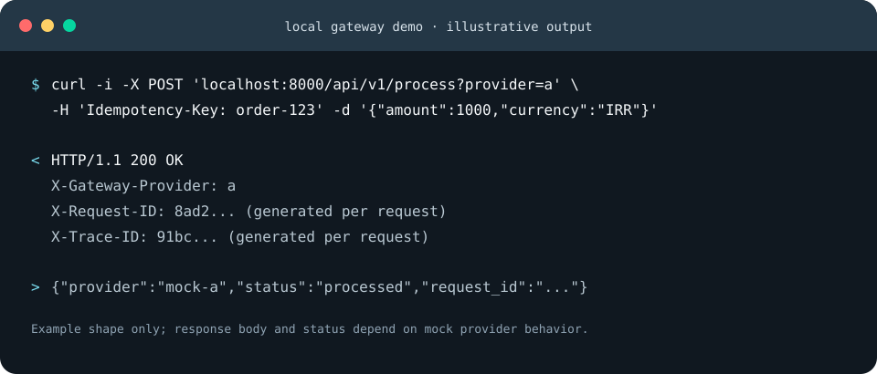
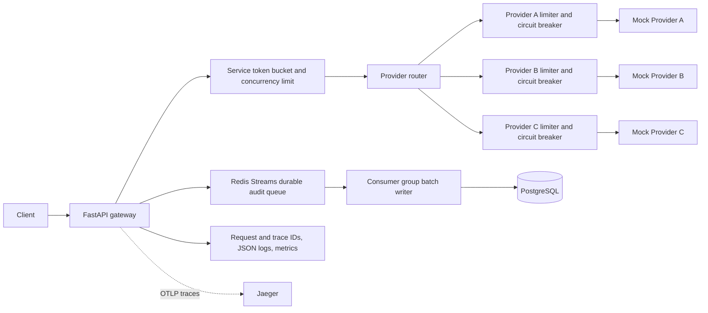

# Multi-Provider API Gateway

An asynchronous FastAPI gateway that routes requests to three mock provider
services, limits upstream load, and records request/result metadata in
PostgreSQL. The configured upstreams are mock services; this project does not
integrate with production provider APIs.

I built this project to explore how a gateway can stay responsive under
upstream limits while preserving an auditable record of each request.



## Run locally

Requirements: Docker and Docker Compose.

```bash
cp .env.example .env
docker compose up --build
```

The API listens on `http://localhost:8000`. `GET /health` checks the API process;
`GET /metrics` exposes Prometheus-format request counters and latency buckets.

Submit a request with a provider selector (`a`, `b`, or `c`):

```bash
curl -i -X POST 'http://localhost:8000/api/v1/process?provider=a' \
  -H 'Content-Type: application/json' \
  -H 'Idempotency-Key: order-123' \
  -d '{"amount": 1000, "currency": "IRR"}'
```

The gateway returns the mock provider response and includes `X-Request-ID`,
`X-Trace-ID`, and `X-Gateway-Provider` response headers. Pass `X-Request-ID` to
correlate a request across services; otherwise the gateway generates one.

## Architecture and request flow



FastAPI and `httpx.AsyncClient` keep upstream I/O asynchronous. Each provider
has an independent token bucket, concurrency cap, and circuit breaker. Retries
are disabled by default. When enabled, they require an idempotency key and only
retry transport failures or 5xx responses with exponential backoff. Provider
4xx responses such as 429 are returned directly and are not retried.

Redis runs with AOF persistence and `noeviction`. An atomic reservation bounds
the audit stream before the gateway accepts work, so a full queue applies
backpressure instead of growing without limit. A Redis consumer group batches
inserts into PostgreSQL; messages are acknowledged and deleted only after the
database transaction succeeds. Retries are safe because each stream entry ID is
unique in the table. Alembic applies schema migrations before API and worker
startup.

The event table stores request/trace IDs, provider, timestamps, duration,
gateway/upstream statuses, request payload, response JSON (or up to 4 KiB of
non-JSON text), and error class. Redis-backed atomic token buckets and expiring
concurrency leases share service and per-provider limits across API replicas.
Expired leases recover capacity after process crashes. Circuit breakers are
currently local to each API process. Structured JSON logs include request and
trace IDs; OpenTelemetry exports HTTP server/client spans to the bundled
Jaeger instance (UI at `http://localhost:16686`).

## Configuration

Copy `.env.example` to `.env`. Provider URLs, timeout values, retry policy,
service capacity, and each provider's rate/burst/concurrency limits are
configurable with environment variables. The defaults are conservative local
limits and should be tuned against the mock provider behavior.

## Benchmark

Commands, methodology, measured results, and the explanation of overload
responses are in [docs/BENCHMARKS.md](docs/BENCHMARKS.md). The short
single-host runs validate request routing and overload handling; they are not
capacity claims. Configured mock upstreams and conservative rate limits
constrain successful throughput.

## Persistence, scaling, and trade-offs

PostgreSQL is the durable system of record; Redis Streams provides a bounded,
durable buffer and consumer-group delivery. Batch inserts reduce database
overhead, and migrations version the schema. The Compose setup is a runnable
single-host demonstration, not a proof of 1,000–10,000 RPS. At that scale,
benchmark and size Redis persistence/network, run multiple API and writer
replicas, tune batch/pool sizes, and partition the event table by time with a
retention policy. Redis-backed rate and concurrency limits are shared across
replicas; circuit breaker state and in-process metrics are not. A shared
breaker could use Redis state per provider, atomic failure-count updates, an
open-until timestamp, and a single half-open probe lease. Prometheus
scrapes each process separately, and Jaeger receives traces over OTLP.

The request payload and response are retained for auditability, which may
include sensitive fields in a real integration. Apply data minimization,
redaction, access controls, and retention limits before production use. Mock
provider latency/rate limits and the single-host Compose setup are likely to be
the main benchmark bottlenecks before the database batch writer is saturated.
